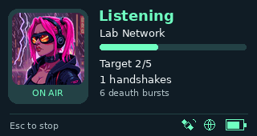
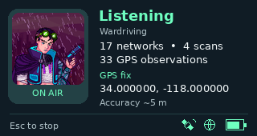

<h1 align="center">Zerogotchi</h1>

<p align="center">
  Wi-Fi lab auditing and GPS-tagged wardriving on the M5Stack Cardputer Zero.<br>
  Opens from the stock launcher.
</p>

<p align="center">
  <a href="https://github.com/unagisan69/Zerogotchi/releases/latest"></a>
</p>

<p align="center">
  <a href="#quick-install">Quick install</a> ·
  <a href="#features">Features</a> ·
  <a href="docs/guide.md">User guide</a> ·
  <a href="CHANGELOG.md">Changelog</a> ·
  <a href="docs/companion.md">wifit3 companion</a>
</p>

| Auto · Acidburn | Wardriving · Zero Cool |
| :--: | :--: |
|  |  |

*Both screens use sample data.*

## Quick install

Run these commands in a terminal on the Cardputer Zero or over SSH.

```sh
curl -fL https://github.com/unagisan69/Zerogotchi/releases/latest/download/zerogotchi_all.deb -o zerogotchi.deb
sudo apt install ./zerogotchi.deb
```

Open **Zerogotchi** in the stock launcher. Use **F/X** or the arrow keys to move, **Enter** to select, and **Esc** to go back or stop a session.

See [installation and troubleshooting](docs/installation.md) for hardware, checksum verification, upgrades, and building from source.

## Features

| Feature | What it does |
| --- | --- |
| **[Auto WiFi Attack](docs/guide.md#auto-wifi-attack)** | Visits eligible access points once, runs capture and directed deauth where the radio and channel allow it, then idles. Skips blocked SSIDs and BSSIDs with saved results. Shows a session-wide deauth count and logs skip reasons. Press **P** to pause or resume. |
| **[Manual WiFi Attack](docs/guide.md#manual-wifi-attack)** | Select an access point for Active Capture, Passive Capture, or Deauth Attack. Follow target and radio activity on the themed dashboard. Capture stops on a usable handshake or PMKID. |
| **[Saved captures](docs/guide.md#saved-captures)** | Review captures by network name. Keeps PCAPs and target-filtered Hashcat mode 22000 files. Includes a confirmed **Clear all handshakes** action. |
| **[Wardriving](docs/guide.md#wardriving)** | Scans Wi-Fi and Bluetooth LE concurrently, shows detections and new addresses separately, and saves new GPS-tagged observations to a local CSV. Press **P** to pause or resume. |
| **[Meshmapping](docs/guide.md#meshmapping)** | Listen for MeshCore advertisements with the SX1262 LoRa cap. See unique nodes and GPS status, save GPS-tagged sightings, and optionally send mapped nodes to WDG Wars. |
| **[Sub-Ghz Monitor](docs/guide.md#sub-ghz-monitor)** | Monitor CC1101 signal strength with a live graph, threshold events, frequency presets, and documented hat profiles. Record, save, and replay raw OOK pulses once or until Esc. Includes an optional GitHub Library import with progress and an SSH-manageable file browser. |
| **[OnlineHashCrack](docs/guide.md#onlinehashcrack)** | Submit WPA hashes from Saved captures, or let Auto send new results after upfront consent. Auto retries temporary connection failures. |
| **[Lifetime Results](docs/guide.md#lifetime-results)** | View Auto and Manual capture counts and success rates, plus Wardriving discovery totals. Reset counters from the dashboard. |
| **[SSID allow list](docs/guide.md#settings-and-dashboard)** | Limit Auto and Wardriving Wi-Fi discovery to specific network names. |
| **[Survey uploads](docs/guide.md#survey-uploads)** | Set up WiGLE with guided API Name and API Token entry and an automatic account check. Send GPS-tagged surveys to WiGLE or WDG Wars, or choose **Upload to All** after Wardriving, or pick a saved survey later. |
| **[Upload queue](docs/guide.md#upload-queue)** | Keep approved uploads across restarts, retry when online, and review each destination’s outcome. |
| **[Diagnostics](docs/guide.md#diagnostics)** | Inspect radio interfaces, GPS, internet, tools, storage, and configuration. |
| **[Private Zones](docs/guide.md#private-zones)** | Pause Wardriving and Meshmapping in GPS circles and filter observations against those zones and the SSID block list before sending. |
| **[Themes and status](docs/guide.md#settings-and-dashboard)** | Choose Acidburn, Computer, or Zero Cool for Auto WiFi Attack, Manual WiFi Attack, and Wardriving. Dashboard indicators use the Cardputer’s live status. Display sleep follows APPLaunch DarkTime. |
| **[In-app updates](docs/installation.md#install-or-upgrade)** | Check automatically on launch or from the main menu. Install a verified release with visible progress and automatic restart. |

The **built-in Wi-Fi adapter** supports scanning and Wardriving on the stock driver. **Capture and deauth** require a USB adapter that supports monitor mode and, for deauth, injection. **GPS-tagged surveys** require a receiver with a position fix: the GNSS HAT/Cap or [M5Stack GPS/BDS Unit v1.1 on Grove](docs/guide.md#grove-gps-unit-v11). Select it under **Settings → GPS Source**.

Use Auto and Manual WiFi Attack only on networks and equipment you own or are authorized to test. The optional [wifit3 companion](docs/companion.md) provides additional lab methods, including active PMKID association, WPS recovery, WEP, and experimental WPA3 downgrade.

Zerogotchi and its bundled theme artwork are available under the [MIT License](LICENSE).
